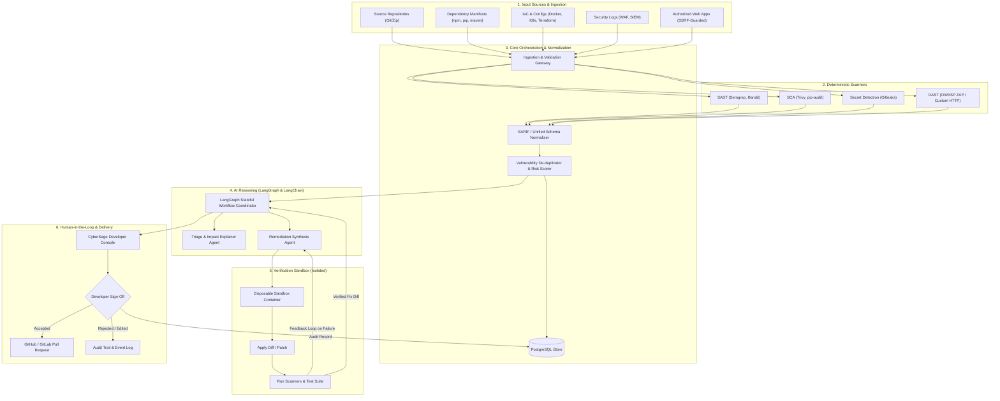

# CyberSage AI

> **AI-Assisted Cybersecurity Detection, Analysis, and Remediation Platform**  
> Developed for the **CyberForge AI & Cybersecurity Hackathon**

---

## Team: Crazy Champions
- **Anurag Jaiswal** ([GitHub @AnuragAJ25](https://github.com/AnuragAJ25))
- **Dhanya Charni**

**Repository**: [https://github.com/AnuragAJ25/CyberSage-AI](https://github.com/AnuragAJ25/CyberSage-AI)  
**Target Branch**: `main`

---

## 1. Problem Statement & Purpose

Modern software teams face an overwhelming volume of vulnerability alerts across source code, third-party libraries, container images, and cloud configurations. Security teams struggle with:
1. **Alert Fatigue & Noise**: Traditional static and dynamic scanners generate thousands of alerts without contextual relevance or exploitability assessment.
2. **Slow Remediation Cycles**: Translating a vulnerability report (e.g., CVE/CWE) into a validated, regression-free code fix requires manual security engineering hours.
3. **Risks of Unchecked AI Automation**: Naive AI-driven coding tools can hallucinate packages, introduce logic breaks, or silently deploy vulnerable changes.

### The Solution: CyberSage AI
CyberSage AI combines deterministic, industry-standard security scanners (Semgrep, Trivy, Gitleaks, ZAP) with bounded AI orchestration (LangGraph + LangChain). It:
- **Discovers & Correlates**: Ingests repositories, dependency manifests, and authorized web applications, normalizing findings into a unified SARIF/JSON schema.
- **Triages & Prioritizes**: AI agents analyze exploitability, attack surfaces, and business impact based on empirical scanner findings.
- **Synthesizes & Verifies**: Generates contextual code remediations and validates them in isolated, ephemeral sandboxes to prevent regressions.
- **Enforces Human-in-the-Loop**: Pull requests are produced **only** after explicit developer review and sign-off. CyberSage AI never merges or deploys automatically.

---

## 2. Feature Roadmap & Status

| Category | Capability | Status | Description |
| :--- | :--- | :--- | :--- |
| **Foundation** | Monorepo Layout & Tooling | **Implemented** | Monorepo structure, unified configurations, CI pipelines, pre-commit hooks. |
| **Foundation** | Core FastAPI Health/Readiness | **Implemented** | Structured logging, typed Pydantic settings, `/api/v1/health` and `/api/v1/ready`. |
| **Foundation** | Web Shell & Empty States | **Implemented** | Next.js 14, Tailwind CSS, dark-mode shell, interactive status monitor. |
| **Scanner Engine** | SAST Scanner (Semgrep) | **Planned** | Deterministic static analysis for Python, JS/TS, Go, Java. |
| **Scanner Engine** | SCA Scanner (Trivy) | **Planned** | Open-source dependency and SBOM vulnerability scanning. |
| **Scanner Engine** | Secret Detection (Gitleaks) | **Planned** | Pattern and entropy-based hardcoded credential detection. |
| **Scanner Engine** | DAST Scanner (ZAP / Custom) | **Planned** | SSRF-guarded dynamic vulnerability scanning for authorized domains. |
| **Correlation** | SARIF Unified Normalizer | **Planned** | Deduplication, CWE/CVE mapping, CVSS scoring. |
| **AI Orchestration** | LangGraph Workflow Coordinator | **Planned** | Bounded stateful analysis graphs for triage and remediation. |
| **AI Orchestration** | Triage & Explainer Agent | **Planned** | Root cause analysis and threat vector explanation. |
| **Verification** | Ephemeral Sandbox | **Planned** | Isolated container environment for test suites and patch verification. |
| **Developer UX** | Interactive Patch Diff Viewer | **Planned** | Unified diff visualization with Accept/Edit/Reject workflow. |
| **Delivery** | GitHub/GitLab PR Integration | **Planned** | Automated branch and pull request generation upon human approval. |

---

## 3. System Architecture



---

## 4. Repository Structure

```text
CyberSage-AI/
├── .github/
│   └── workflows/
│       └── ci.yml                 # GitHub Actions quality gate (backend + frontend)
├── apps/
│   ├── api/                       # FastAPI Backend Service
│   │   ├── app/
│   │   │   ├── api/
│   │   │   │   └── v1/
│   │   │   │       ├── endpoints/ # Health, readiness, and future scanner routes
│   │   │   │       └── router.py  # Versioned API Router
│   │   │   ├── core/              # Config (Pydantic Settings), logging, error handlers
│   │   │   └── main.py            # FastAPI entry point & lifespan
│   │   ├── tests/                 # Backend pytest test suite
│   │   ├── pyproject.toml         # Python packaging, Ruff, Mypy & Pytest configurations
│   │   ├── requirements.txt       # Production dependencies
│   │   └── requirements-dev.txt   # Development & testing tooling
│   └── web/                       # Next.js 14 Frontend Console
│       ├── src/
│       │   ├── app/               # Next.js App Router (pages & layouts)
│       │   └── components/        # UI shell, cards, status indicators, badges
│       ├── public/                # Static assets & branding
│       ├── package.json           # Node dependencies and scripts
│       ├── tsconfig.json          # Strict TypeScript configuration
│       └── tailwind.config.ts     # CyberSage design system tokens
├── docs/
│   ├── adr/
│   │   └── 0001-monorepo-and-core-stack.md # Initial Architecture Decision Record
│   ├── architecture.md            # Deep-dive system architecture specification
│   └── threat-model.md            # STRIDE threat model & boundary defenses
├── fixtures/                      # Mock repos, manifests, and scanner outputs
├── infra/                         # Docker compose & deployment infrastructure
├── scripts/                       # Developer automation scripts
├── tests/                         # Cross-cutting E2E & security test suites
├── .editorconfig                  # Formatting standards across editors
├── .env.example                   # Reference environment variables template
├── .gitignore                     # Comprehensive git ignore rules
├── .pre-commit-config.yaml        # Pre-commit git hooks configuration
├── CHANGELOG.md                   # Chronological release notes
├── CONTRIBUTING.md                # Development guidelines & quality standards
├── README.md                      # Project master documentation
└── SECURITY.md                    # Vulnerability reporting & security architecture
```

---

## 5. Technology Stack & Roles

| Technology | Category | Role in CyberSage AI |
| :--- | :--- | :--- |
| **Python 3.12+ / FastAPI** | Backend Framework | High-performance asynchronous API, scanner orchestration, WebSocket alerts. |
| **Pydantic v2 & Settings** | Data Validation | Strict data typing, schema enforcement, environment parsing, and LLM output guardrails. |
| **Next.js 14+ / React** | Frontend Framework | Developer dashboard, vulnerability triage interface, and remediation approval console. |
| **TypeScript (Strict)** | Frontend Language | Compile-time type safety preventing UI runtime defects. |
| **Tailwind CSS** | Styling | Responsive cyber-defense design system with accessible dark mode. |
| **PostgreSQL & SQLAlchemy** | Persistence | Relational store for scans, normalized findings, audit trails, and approvals. |
| **Redis** | In-Memory Broker | Task queue and async job coordination for long-running scanner executions. |
| **LangGraph & LangChain** | AI Orchestration | Stateful agent loops for vulnerability explanation, fix generation, and reflection. |
| **Ruff & Mypy** | Code Quality | Sub-second Python linting, formatting, and strict static type checking. |
| **Pytest & HTTPX** | Testing | Unit, integration, and asynchronous API endpoint testing. |

---

## 6. Prerequisites & Reproducible Local Setup

### Prerequisites
- **Python**: `3.12` or `3.13`
- **Node.js**: `>= 20.0.0`
- **npm**: `>= 10.0.0`
- **Git**: `>= 2.30`

### Step 1: Clone & Navigate
```bash
git clone https://github.com/AnuragAJ25/CyberSage-AI.git
cd CyberSage-AI
```

### Step 2: Environment Configuration
Copy the template configuration into `.env`:
```bash
cp .env.example .env
```
*(In Windows PowerShell: `Copy-Item .env.example .env`)*

### Step 3: Backend Setup
```bash
# Create and activate Python virtual environment
python -m venv .venv
source .venv/bin/activate  # On Windows: .\.venv\Scripts\Activate.ps1

# Install dependencies
pip install -r apps/api/requirements.txt
pip install -r apps/api/requirements-dev.txt
```

### Step 4: Frontend Setup
```bash
cd apps/web
npm install
cd ../..
```

---

## 7. Running the Platform Locally

### Starting the Backend
```bash
# From workspace root with activated venv:
cd apps/api
uvicorn app.main:app --reload --host 0.0.0.0 --port 8000
```
- API Root: `http://localhost:8000`
- Interactive OpenAPI Docs: `http://localhost:8000/docs`
- Health Endpoint: `http://localhost:8000/api/v1/health`
- Readiness Endpoint: `http://localhost:8000/api/v1/ready`

### Starting the Frontend
```bash
cd apps/web
npm run dev
```
- Frontend UI: `http://localhost:3000`

### Docker Infrastructure (Optional / Database & Cache)
```bash
docker-compose -f infra/docker-compose.yml up -d
```

---

## 8. Quality Gates, Tests, and Linting Commands

| Target | Command | Purpose |
| :--- | :--- | :--- |
| **Backend Lint** | `cd apps/api && ruff check .` | Verifies linting rules and imports. |
| **Backend Format Check** | `cd apps/api && ruff format --check .` | Checks code formatting. |
| **Backend Type Check** | `cd apps/api && mypy app tests` | Enforces strict static type signatures. |
| **Backend Tests** | `cd apps/api && pytest -v` | Executes unit and endpoint test suites. |
| **Frontend Lint** | `cd apps/web && npm run lint` | ESLint verification on TSX/TS sources. |
| **Frontend Type Check** | `cd apps/web && npm run type-check` | Runs TypeScript compiler validation without emit. |
| **Frontend Build** | `cd apps/web && npm run build` | Builds optimized production Next.js bundle. |

---

## 9. Security Model & Sandbox Boundaries

CyberSage AI adheres to strict defense-in-depth principles:
1. **Never Execute Untrusted Scanned Code on the Host**: Third-party repositories are mounted in read-only mode during scanning.
2. **SSRF Guardrails**: Target URLs for web scanning must undergo explicit domain ownership verification. Cloud metadata IPs (`169.254.169.254`) and private subnets (`10.0.0.0/8`, `172.16.0.0/12`, `192.168.0.0/16`, `127.0.0.0/8`) are rejected.
3. **Prompt Injection Mitigation**: Code snippets, manifests, and scanner outputs are isolated in prompt templates as untrusted data. AI agents emit structured schemas validated through Pydantic.
4. **Mandatory Human-in-the-Loop**: Pull requests require explicit developer approval. Auto-merge and auto-deployment are disabled by architectural constraint.

---

## 10. Third-Party Tools & Acknowledgements

CyberSage AI integrates with and acknowledges the following open-source cybersecurity tools and libraries:
- [Semgrep](https://semgrep.dev/) — Fast static analysis for discovering security bugs.
- [Trivy](https://aquasecurity.github.io/trivy/) — Comprehensive security scanner for container images and dependency manifests.
- [Gitleaks](https://github.com/gitleaks/gitleaks) — Secret scanning for detecting exposed API keys and tokens.
- [OWASP ZAP](https://www.zaproxy.org/) — Dynamic application security testing.
- [FastAPI](https://fastapi.tiangolo.com/) — Modern, fast Python web framework.
- [LangChain](https://www.langchain.com/) & [LangGraph](https://www.langchain.com/langgraph) — Resilient agent orchestration framework.

---

## 11. Known Limitations & Roadmap

- **Phase 1 Baseline**: Phase 1 establishes the monorepo foundation, CI workflows, docs, and health monitoring. Scanner modules and AI orchestration will be integrated in subsequent phases.
- **In-Memory vs. PostgreSQL**: Phase 1 uses lightweight health checks. Phase 2 introduces full SQLAlchemy migrations and database persistence.
- **Mock Sandbox vs. MicroVMs**: Future iterations will support Firecracker / gVisor sandboxes for microsecond VM isolation during patch verification.
