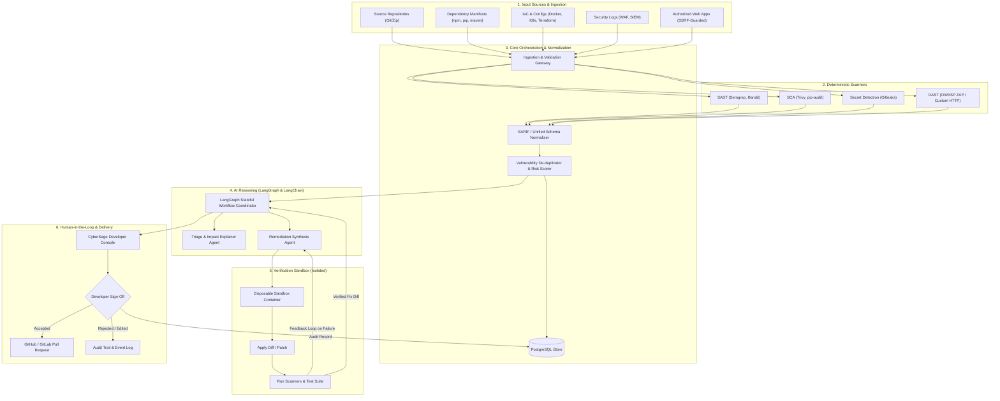

# CyberSage AI - System Architecture

CyberSage AI is an AI-assisted cybersecurity detection, analysis, and remediation platform. It combines deterministic static and dynamic security scanners with bounded LLM orchestration to detect vulnerabilities, explain their operational impact, synthesize verified remediations, and present pull-request-ready changes for human review.

## High-Level Architecture Diagram

## System Components

### 1. Ingestion Layer
- Accepts code repositories, dependency manifests, configuration files, and authorized web URLs.
- Applies strict size limits, archive unpack quotas (zip-slip defense), and SSRF validation for web targets.

### 2. Deterministic Scanner Tier
- Runs isolated scanners (Semgrep, Trivy, Gitleaks, etc.) emitting standard machine-readable outputs (SARIF, JSON).
- Scanner outputs represent empirical ground truth; LLMs are never used as substitute scanners.

### 3. Normalization & Correlation
- Standardizes diverse scanner payloads into a canonical `Finding` schema with CVE, CWE, CVSS v3.1, file coordinates, and contextual code snippets.
- Deduplicates identical findings across scanner tools and correlates related security issues.

### 4. AI Orchestration (LangGraph + LangChain)
- Coordinates bounded reasoning workflows using state machines.
- **Triage Agent**: Explains vulnerability mechanics, attack vectors, and exploitability.
- **Remediation Agent**: Produces unified diffs tailored to the codebase without introducing regressions or hallucinated dependencies.
- Enforces strict Pydantic output schemas and treats inputs as untrusted data to mitigate prompt injection.

### 5. Verification Sandbox
- Executes in an isolated disposable sandbox with resource and timeout bounds.
- Applies the proposed patch, runs linters, unit tests, and rescans the target to verify that the vulnerability is neutralized without breaking existing functionality.

### 6. Human-in-the-Loop Approval & PR Engine
- Surfaces findings, AI explanations, verified diffs, and test results in the developer console.
- Grants final authority to human developers: Accept, Edit, or Reject.
- Automated merging or unapproved deployment is strictly prohibited.
